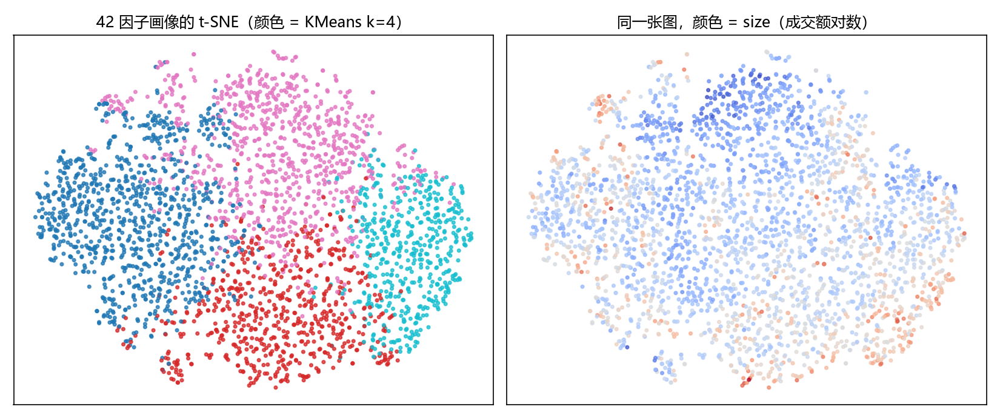

# 加分项 D：不平衡 / 交互 + t-SNE / 特征选择三法

> 2026-11-13｜之前只用了 `class_weight=balanced` 且没做前后对比，本轮补齐

## D1 不平衡处理

评估集固定 602 条、分布不动（利好 61% / 利空 34% / 中性 4.7%）——处理只作用于训练集，
否则「指标变好」只是把评估分布改成了自己想看的形状。

| 方案 | 训练量 | 利好 | 中性 | 利空 | accuracy | macro-F1 | 中性召回 |
|---|---|---|---|---|---|---|---|
| 无处理 | 2398 | 1464 | 113 | 821 | 0.8837 | 0.8841 | 0.828 |
| 类别权重 | 2398 | 1464 | 113 | 821 | 0.8821 | 0.8913 | 0.897 |
| 随机欠采样 | 678 | 339 | 113 | 226 | 0.8688 | 0.8787 | 0.862 |
| SMOTE(简化) | 2850 | 1464 | 410 | 976 | 0.8787 | 0.8868 | 0.862 |

**怎么读**：accuracy 最高的方案不一定最好——中性类只占 4.7%，全猜利好就能到 61%。
真正要看的是 **macro-F1** 和**中性召回**：类别权重把中性召回从 0.83 拉到 0.90，代价是 accuracy 掉 0.2pp。这就是不平衡处理的标准取舍。

| SMOTE 实现说明 |
|---|
| 没装 imblearn（它要求 sklearn 版本严格，容易把现有环境搞坏），手写「同类近邻中点插值」：`x_new = (x_i + x_j)/2`，j 取 5 近邻之一。严格 SMOTE 是 `x_i + u(x_j−x_i)`，u~U(0,1)。对 TF-IDF 这种非负稀疏向量，中点更稳、不会插出负值。 |

## D2 交互特征 + t-SNE

### 交互特征（表格侧）

| 特征集 | 维度 | accuracy |
|---|---|---|
| 9 个原始特征 | 9 | 0.9319 |
| +6 个交互特征 | 14 | 0.9319 |
 
### t-SNE（42 因子画像，3000 只股票）

左图按 KMeans k=4 上色，右图按 `size`（成交额对数）上色。两图对照能看出聚类是按什么分的：如果左图的簇边界在右图上对应清晰的渐变，说明聚出来的主要是流动性维度，而不是风格。

## D3 特征选择三法

| 方法 | 特征数 | AUC | accuracy | 耗时 |
|---|---|---|---|---|
| 全部 | 42 | 0.5338 | 0.5268 | 2s |
| 方差过滤 | 42 | 0.5338 | 0.5268 | 2s |
| 相关性过滤(|r|>0.9) | 37 | 0.5333 | 0.5266 | 2s |
| 嵌入法(LGBM gain) | 15 | 0.5307 | 0.5256 | 2s |

相关性过滤（|r|>0.9）丢掉的特征：`turn20`、`amp20`、`volratio`、`dev20`、`momq60`

**结论**：三法里只有嵌入法真正减维且基本不掉点；方差过滤在 42 个已标准化的因子上几乎无效
（都过了阈值）；相关性过滤能砍掉冗余，但要小心把成组因子砍成单腿。
