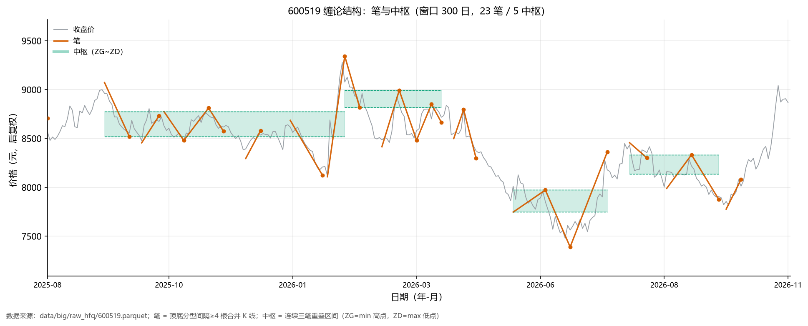

# 缠论因子：把「分型/笔/中枢/背驰」变成可计算的截面因子

> 2026-11-14｜1,500 只随机股票 × 2016-2024｜日频截面 rank IC vs `Y2`（5 日前向超额，已截面去均值）
> 代码：`scripts/chan_factors.py`（结构 + 10 因子）、`chan_check.py`（增量检验）、`chan_plot.py`（结构图）

## 一、缠论里能算的只有四层结构

缠论原文是交易体系，不是因子库。抛开"走势必完美""级别扩张"这类叙述，能写成代码的只有四件事：

| 层 | 规则（本文采用） | 参数 |
|---|---|---|
| **K 线合并** | 相邻两根有包含关系（一根的高低点完全包住另一根）就合并，方向由前一根决定 | — |
| **分型** | 合并后三根 K 线，中间的高点最高且低点最高 = 顶分型；反之 = 底分型 | — |
| **笔** | 顶底分型交替，两个分型中心间隔 ≥4 根合并 K 线才成笔；同向取更极端 | `MIN_GAP=4` |
| **中枢** | 连续三笔的重叠区间：ZG = 三笔高点的最小值，ZD = 三笔低点的最大值，ZG>ZD 才成立；后续笔仍重叠则延伸 | 至少 3 笔 |
| **背驰** | 同向两笔比 MACD（12/26/9）面积：价格创新极值但面积缩小到 90% 以下 | `0.9` |

单只股票（茅台 2,878 根日线）跑出来的结构量级：合并后 2,202 根（合并率 23%）、分型 1,014 个（顶底各半）、**笔 243 个**（平均 6 根合并 K 线一笔）、**中枢 37 个**（平均跨度 5.9 笔）。这个密度和看图的经验一致。



## 二、10 个因子

| 因子 | 定义 | 想抓的东西 |
|---|---|---|
| `chan_bi_dir` | 当前笔方向（+1 上行 / −1 下行） | 短期趋势 |
| `chan_bi_days` | 当前笔已走几根日线 | 笔的"年龄"，越老越接近转折 |
| `chan_bi_amp` | 当前笔幅度（相对起点） | 短线涨跌幅 |
| `chan_bi_speed` | 幅度 / 天数 | 斜率 |
| `chan_zs_pos` | 收盘价在中枢里的相对位置（0=ZD，1=ZG） | 中枢内的强弱位置 |
| `chan_zs_width` | (ZG−ZD) / 中轴 | 盘整的松紧 |
| `chan_zs_n60` | 过去 60 日新形成的中枢个数 | 趋势 vs 震荡 |
| `chan_zs_break` | 向上突破中枢的强度（close>ZG 时 = 超出幅度/中枢宽度） | 三买的前置条件 |
| `chan_div` | 近 10 日内的背驰（+1 底背驰 / −1 顶背驰） | 力度衰竭 |
| `chan_fx_age` | 距最近一个分型几根日线 | 转折的新鲜度 |

**中枢有有效期（40 根合并 K 线）**。不加这个限制，价格早就走远了，`zs_pos` 会长期顶在裁剪上限，95% 的样本饱和成同一个值——因子就废了。加了之后覆盖率从 100% 降到 47%（只在"手里有一个还作数的中枢"时才有值）。

## 三、一个必须先修的因果问题

第一版跑出来 `chan_zs_pos` 的残差 IC 是 **+0.0220**、五分位 Q5−Q1 年化 **+19.7%**，好得不像真的。

问题出在**合并 K 线是一根一根"压缩"的**：分型要等下一根合并 K 线走完才确认，而一根合并 K 线含 2~3 根日线。我把状态直接按"合并 K 线索引"映射回日线，等于在**这一组的第一天**就用上了要到**这一组最后一天**才能确认的信息。

修法：所有结构状态（笔方向/起点、中枢 ZG/ZD、背驰、分型年龄）统一**滞后一根合并 K 线**（约 5 个交易日），宁可保守。修完：

| | 修正前 | 修正后 |
|---|---|---|
| `chan_zs_pos` 残差 IC | +0.0220 | **+0.0115** |
| 五分位 Q5−Q1 年化 | +19.7% | **+15.2%** |
| 分型年龄 IC | −0.0001 | +0.0059 |

**效果砍掉一半。** 这类"状态量映射"的泄漏在路径依赖型指标里非常常见（做网格、做形态、做 HH/HL 结构都会踩），而且比标签泄漏更隐蔽——它不碰 Y，只碰 X 的时间对齐。

## 四、单因子 IC

| 因子 | IC | ICIR | 胜率 | 覆盖（抽样内） |
|---|---|---|---|---|
| `chan_bi_speed` | **−0.0316** | −0.27 | 39.9% | 74% |
| `chan_bi_amp` | **−0.0315** | −0.25 | 40.1% | 74% |
| `chan_zs_pos` | −0.0241 | −0.18 | 42.1% | 47% |
| `chan_zs_width` | −0.0239 | −0.22 | 41.0% | 47% |
| `chan_zs_break` | −0.0134 | −0.10 | 45.8% | 47% |
| `chan_zs_n60` | −0.0096 | −0.19 | 42.6% | 74% |
| `chan_div` | +0.0081 | +0.16 | 55.7% | 74% |
| `chan_bi_dir` | +0.0074 | +0.10 | 54.0% | 74% |
| `chan_fx_age` | +0.0059 | +0.09 | 53.8% | 74% |
| `chan_bi_days` | +0.0017 | +0.03 | 51.1% | 74% |

全部是**反转方向**：笔涨得越多、速度越快，未来 5 日越差；中枢越宽（盘整越松），未来越差。方向一致得有点可疑，但其实就是 A 股短周期反转的另一种写法——下一节验证。

## 五、增量检验：绝大多数是"换皮"

### ① 与 42 个现有因子的截面秩相关

| 缠论因子 | 最相关 | 相关 |
|---|---|---|
| `chan_bi_amp` | `dev20` / `wvma20` / `ret10` | 0.64 / 0.62 / 0.57 |
| `chan_bi_speed` | `dev20` / `wvma20` / `ret5` | 0.60 / 0.59 / 0.55 |
| `chan_zs_width` | `std60` / `amp20` / `turn60` | 0.34 / 0.30 / 0.28 |
| `chan_zs_pos` | `momq60` / `ret60` / `dev60` | 0.68 / 0.66 / 0.65 |
| `chan_div` | `dev60` / `momq60` / `ret60` | −0.17 / −0.14 / −0.14 |

`chan_bi_amp` 与 `dev20` 的相关 **0.64**——"当前笔涨了多少"基本等于"价格偏离 20 日均线多少"。缠论叫它"笔"，因子库里叫它 `dev20`。

### ② 剔除最相关两因子后的残差 IC

| 因子 | 原始 IC | 残差 IC | 保留 | 控制变量 |
|---|---|---|---|---|
| `chan_bi_amp` | −0.0315 | +0.0040 | −13% | dev20 + wvma20 |
| `chan_bi_speed` | −0.0316 | −0.0067 | 21% | dev20 + wvma20 |
| `chan_zs_width` | −0.0239 | +0.0025 | −10% | std60 + amp20 |
| **`chan_zs_pos`** | −0.0241 | **+0.0115** | −48% | momq60 + ret60 |
| `chan_div` | +0.0081 | **−0.0239** | −295% | dev60 + momq60 |

两件事：

1. **`bi_amp`、`zs_width` 的 IC 全部来自已有因子**（残差 ≈ 0），零增量。
2. **`zs_pos` 和 `div` 的符号翻转了**，而且不是笔误——残差与原因子的截面相关是 +0.65（同向），说明分解是对的：
   - `zs_pos` 的负 IC 来自它和 `momq60` 的正相关（涨多了要跌）；把动量剥掉之后，**"在同一中枢里站得越高"本身是正向的**（+0.0115，9 年全正）。
   - `chan_div` 的 +0.008 全部来自"这只股票已经跌了很多"；把超跌剥掉之后，**背驰反而是负向的**（−0.0239，9 年全负）。

### ③ 分年度稳定性（残差）

| 年份 | `bi_amp` | `bi_speed` | `zs_width` | **`zs_pos`** | **`div`** |
|---|---|---|---|---|---|
| 2016 | +0.017 | −0.001 | +0.012 | **+0.012** | −0.041 |
| 2017 | +0.011 | −0.011 | +0.004 | **+0.019** | −0.003 |
| 2018 | −0.003 | −0.010 | −0.006 | **+0.002** | −0.030 |
| 2019 | +0.008 | −0.002 | +0.003 | **+0.003** | −0.011 |
| 2020 | +0.015 | −0.003 | +0.010 | **+0.017** | −0.017 |
| 2021 | −0.003 | −0.010 | +0.013 | **+0.019** | −0.024 |
| 2022 | −0.008 | −0.010 | −0.004 | **+0.004** | −0.022 |
| 2023 | +0.008 | +0.003 | −0.011 | **+0.014** | −0.031 |
| 2024 | −0.007 | −0.017 | +0.002 | **+0.015** | −0.037 |

`zs_pos` **9 年全正**、`div` **9 年全负**。其余三个符号来回跳。

### ④ 五分位组合（残差因子，Y2 年化）

| 因子 | Q1 | Q2 | Q3 | Q4 | Q5 | Q5−Q1 |
|---|---|---|---|---|---|---|
| `chan_zs_pos` | −10.2% | −2.9% | +0.3% | +1.2% | +4.9% | **+15.2%** |
| `chan_div` | −1.0% | +1.7% | +2.9% | +0.1% | −9.2% | −8.2% |
| `chan_bi_speed` | −0.9% | +1.4% | −0.3% | +0.4% | −6.0% | −5.1% |

`zs_pos` 的五组几乎单调（−10.2 → −2.9 → +0.3 → +1.2 → +4.9），不是靠某一端拉出来的。

**稳健性**：残差与 `size` 相关 +0.07、与 `turn5` +0.10、与 `illiq20` −0.03，不是市值或换手的替身；按市值三分组各自算 Q5−Q1，年化 **11.0% / 17.5% / 19.2%**（大市值里更强）。

## 六、结论

1. **缠论的主流结构（笔、中枢宽度）不是新因子**，是 `dev20` / `wvma20` / `std60` 的重排；`bi_amp` 与 `dev20` 相关 0.64，残差归零。
2. **唯一有增量的是"中枢内相对位置"**：剔除中期动量后 IC **+0.0115**、9 年全正、Q5−Q1 年化 +15.2%，且在大小市值分组内都成立。用缠论的话说，"中枢上移"确实是个正向结构；用因子的话说，"同动量下谁离自己箱体上沿更近"。
3. **"背驰"作为买入信号是错的**：原始 IC 为正只因为它筛出了超跌股；控制超跌后 **9 年全为负**，等于告诉你"跌了很多且力度衰竭"的股票还要继续跌。这条和流行的用法完全相反。
4. **实现缠论最大的风险不是参数，是时间对齐**。这次一个"合并 K 线组内提前用状态"的问题，把效应从 +0.022 虚增到（虚假的）+0.0220，修正后腰斩。

## 七、局限

- 只用日线，没做**线段**（需要至少三笔且破坏前一笔的极值，规则本身有歧义），也没做多级别联立（30 分钟/日线共振），这两块恰恰是缠论的核心；
- 中枢只保留"最近一个"，没有处理中枢新生/扩展/九段以上升级；
- 背驰只用了 MACD 面积这一种判据，没做区间套；
- 1,500 只抽样、单一 5 日标签（后续已补全市场 5 折 Purged CV：**通过**，`chan_cv.md`——
  三臂 5 折 Δ+0.0153 / t=9.9 / 0 折下降，泄漏探针三个对照全部通过）；
- 五分位的"年化"是 5 日超额均值 × 50，未计成本；`zs_pos` 每日重排，换手极高，实盘要打折。

## 八、复现

```bash
python scripts/chan_factors.py     # 结构 + 10 因子 IC，40 秒
python scripts/chan_check.py       # 相关性 / 残差 / 分年 / 五分位，100 秒
python scripts/chan_plot.py 600519 300   # 结构示意图
```
