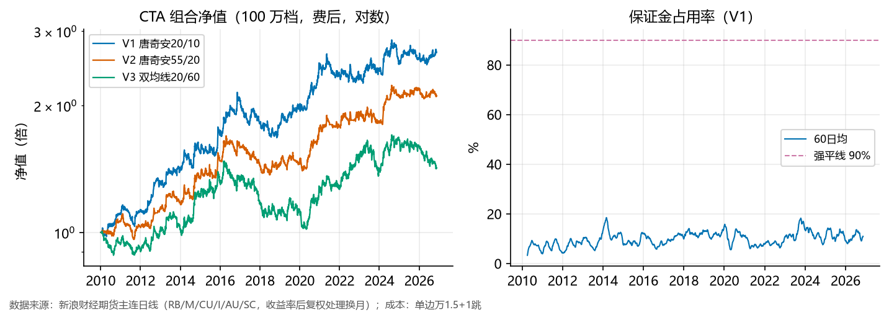

# 国内商品期货 CTA 回测：六品种主连，规则全展示

**一句话**：三套 a priori 经典规则（唐奇安 20/10、55/20、双均线 20/60）× 六品种（螺纹/豆粕/沪铜/铁矿石/黄金/原油）波动率目标组合，整手交易、停板顺延、三倍保证金规则、换月成本全建模；2010-01 起费后回测。

## 用户点名的四条现实约束 → 建模方式

| 约束 | 建模 |
|---|---|
| 最小开仓手数 | 整手（1 手起）+ 100 万/500 万两档对照，量化粒度损失 |
| 昨仓/今仓 | 信号收盘出、次日执行、持仓必过夜 → 平仓全走平昨普通费率；结构上不触发平今；换月=平昨旧+开今新 |
| 停板累计规则（郑商所式，即「周三三倍」所指的 3 倍提保条款） | 4 日累计涨跌幅 ≥ 3×停板幅度 → 保证金 ×3；占用超 90% 权益强制减仓 |
| 临时规则（停板无法成交） | 收盘=板价且 |ret|≥板幅×0.9 → 顺延至多 3 日 |

## 总结果（2010-01 ~ 2026-11，费后）

| 变体 | 本金 | 年化 | 夏普 | 最大回撤 | Calmar | 成交手数 | 强平次数 |
|---|---|---|---|---|---|---|---|
| V1 唐奇安20/10 | 100 万 | 6.00% | 0.62 | -22.0% | 0.27 | 16707 | 0 |
| V1 唐奇安20/10 | 500 万 | 8.13% | 0.72 | -23.6% | 0.34 | 94627 | 0 |
| V1 唐奇安20/10 | 100 万压力档 | 5.63% | 0.59 | -21.7% | 0.26 | 15751 | 0 |
| V2 唐奇安55/20 | 100 万 | 4.52% | 0.54 | -19.2% | 0.24 | 6932 | 0 |
| V2 唐奇安55/20 | 500 万 | 5.21% | 0.51 | -21.2% | 0.25 | 37642 | 0 |
| V2 唐奇安55/20 | 100 万压力档 | 4.41% | 0.52 | -18.8% | 0.23 | 6810 | 0 |
| V3 双均线20/60 | 100 万 | 2.12% | 0.21 | -31.1% | 0.07 | 8288 | 0 |
| V3 双均线20/60 | 500 万 | 3.69% | 0.29 | -31.6% | 0.12 | 48542 | 0 |
| V3 双均线20/60 | 100 万压力档 | 1.20% | 0.12 | -32.9% | 0.04 | 7712 | 0 |

压力档 = 手续费 ×2（万3）+ 保证金率 ×1.5（节前提保代理）。

## 分年（V1，100 万档）

| 年份 | 收益 |
|---|---|
| 2010 | +11.2% |
| 2011 | +1.8% |
| 2012 | +16.3% |
| 2013 | +7.3% |
| 2014 | +9.4% |
| 2015 | +11.9% |
| 2016 | +18.5% |
| 2017 | -11.0% |
| 2018 | -1.3% |
| 2019 | +9.7% |
| 2020 | +25.5% |
| 2021 | -4.8% |
| 2022 | +0.4% |
| 2023 | +2.2% |
| 2024 | +4.0% |
| 2025 | +2.9% |
| 2026 | +3.0% |

## 分品种：策略腿 vs 买入持有（V1）

| 品种 | 腿年化 | 腿夏普 | 腿回撤 | B&H 年化 | B&H 夏普 | B&H 回撤 |
|---|---|---|---|---|---|---|
| 螺纹钢 | 5.53% | 0.52 | -15.3% | 1.31% | 0.06 | -72.0% |
| 豆粕 | 3.49% | 0.31 | -24.2% | 4.34% | 0.20 | -51.1% |
| 沪铜 | 1.58% | 0.19 | -20.4% | 6.69% | 0.30 | -71.5% |
| 铁矿石 | 2.20% | 0.23 | -21.1% | 9.86% | 0.25 | -60.2% |
| 黄金 | 2.38% | 0.29 | -24.3% | 6.38% | 0.36 | -46.4% |
| 原油 | 1.26% | 0.23 | -13.2% | 2.54% | 0.07 | -76.0% |

## 已知近似（读数字前必看）

1. **主连 + 收益率后复权**：换月日按持仓量跳增 >35% 判定（启发式），当日假价差清零、另收换月成本；未逐合约重建主力切换，极端贴水结构下会低估展期损益；
2. **成交价 = 次日收盘价**：真实应在盘中/开盘，1 跳滑点是保守下限；
3. 停板幅度/保证金率/手续费用近似常数值（历史上交易所调过多次），压力档是代理；保证金三倍规则用郑商所条款近似推广到全部品种；
4. 保证金占用之外的现金按 0 利息（保守，实际可买货基/国债贴 2%%）；
5. 参数是 a priori 经典值、三变体全展示不选优——但品种池（六个）本身就是挑过的，「六品种里选六个」存在选择偏差，扩池重算是后续工作。

## 与项目内其他趋势证据的关系

- 指数上的网格/海龟/MACD 全军覆没（夏普 0.1~0.2），但那是**单资产低杠杆**；本回测是**多品种+波动率目标+可做空**——CTA 的收益来源三者缺一不可；
- 原油单品种趋势（夏普 1.3~1.7，样本止于 2020-04）与本结果互为印证；
- 本策略与 A 股面板/禁买清单完全独立（不同市场、不同数据通道），按项目规矩单独存档评估，不进 42 因子体系。