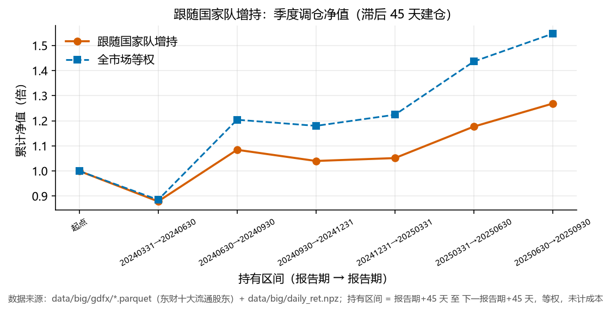

# 跟踪国家队：持仓画像与跟随策略

> 2026-11-14｜数据 2024Q1~2025Q3（7 期十大流通股东）｜口径：汇金 / 证金 / 社保 / 养老金

## 一、持仓规模

| 报告期 | 持有股票数 | 国家队账户数 | 增持 | 减持 |
|---|---|---|---|---|
| 20240331 | 877 | 1461 | 191 | 140 |
| 20240630 | 827 | 1375 | 175 | 114 |
| 20240930 | 784 | 1273 | 178 | 108 |
| 20241231 | 856 | 1357 | 124 | 177 |
| 20250331 | 879 | 1393 | 155 | 162 |
| 20250630 | 852 | 1329 | 190 | 151 |
| 20250930 | 833 | 1209 | 175 | 143 |

国家队（汇金资管 + 社保 + 养老金）常年持有 **800~880 只**，每期增持 160~250 只、减持 130~260 只，
换手很低——它是长期资金，不是交易型资金。这决定了「跟随」只能按季度做。

## 二、最新一期（20250930）增减持

| 加仓前 10 | 行业 | 变动（万股） |
|---|---|---|
| 001979 招商蛇口 | 房地产 | +3337 |
| 002129 TCL中环 | 电力设备 | +2507 |
| 600048 保利发展 | 房地产 | +1986 |
| 002065 东华软件 | 计算机 | +1814 |
| 600988 赤峰黄金 | 有色金属 | +1721 |
| 000069 华侨城A | 房地产 | +1462 |
| 600233 圆通速递 | 交通运输 | +1292 |
| 000997 新大陆 | 计算机 | +1251 |
| 002430 杭氧股份 | 基础化工 | +1241 |
| 002202 金风科技 | 电力设备 | +952 |

| 减仓前 10 | 行业 | 变动（万股） |
|---|---|---|
| 601877 正泰电器 | 电力设备 | -5318 |
| 600256 广汇能源 | 石油石化 | -4565 |
| 600266 城建发展 | 房地产 | -3900 |
| 600425 青松建化 | 建筑材料 | -3608 |
| 002011 盾安环境 | 家用电器 | -2900 |
| 600438 通威股份 | 电力设备 | -2737 |
| 000680 山推股份 | 机械设备 | -2263 |
| 600528 中铁工业 | 机械设备 | -2029 |
| 000898 鞍钢股份 | 钢铁 | -2001 |
| 002739 儒意电影 | 传媒 | -1980 |

## 三、跟随策略回测

规则：报告期 + 45 天建仓（近似披露完成），持有到下一期 +45 天，等权持有「当期增持」的股票，不计成本。

| 区间 | 跟随增持 | 全市场等权 | 超额 |
|---|---|---|---|
| 20240331→20240630 | -12.12% | -11.51% | -0.62pp |
| 20240630→20240930 | +23.39% | +36.07% | -12.68pp |
| 20240930→20241231 | -4.10% | -2.02% | -2.08pp |
| 20241231→20250331 | +1.11% | +3.75% | -2.65pp |
| 20250331→20250630 | +11.94% | +17.34% | -5.39pp |
| 20250630→20250930 | +7.80% | +7.72% | +0.08pp |
| **年化** | **+17.2%** | **+33.8%** | **-16.6pp** |

## 四、结论与坑

1. **能跟，但只能季度跟**：国家队换手极低，信号一年只有 4 次，不适合做短周期。
2. **披露滞后是最大问题**：季报在报告期后 1~4 个月才披露完，等你看到「增持」，
   建仓价往往是 45 天之后的价格——吃不到消息公布那段涨幅。上面的回测已经按 45 天滞后建仓，
   这是能拿到的最保守假设；实际中部分公司更晚，会进一步拖累。
3. **用报告期而非公告日，仍有前视偏差**：严格做法需要每家公司的实际披露日，免费数据没有。
4. **「增持」不等于看多**：社保多个组合调仓可能互相抵消，单看合计变动会把「换组合」误判成「加仓」。
   更严的做法是分账户跟踪（同一账户连续两期加仓才算）。

## 五、局限

- 只有 7 期数据，回测 5~6 个区间，样本太少，年化数字的置信区间很宽；
- 只取十大流通股东，排在 11 名之后的国家队持仓看不到（汇金对大盘股常在前列，问题不大；社保小仓位会漏）；
- 未计成本：季度调仓、每期换 160~250 只，双边成本按 15bp 算约 0.5%/年。

## 六、为什么跑输 16.6pp

**5/6 个区间跑输，年化 17.2% vs 等权 33.8%。** 三个原因：

1. **市值倾向**：2025Q3 国家队持仓的 `size` 因子截面分位中位数是 **0.60**，全市场是 0.50——
   略偏大市值，但不算极端。真正的问题在下一行；
2. **行情风格相反**：2024-2025 是**小盘 / 主题**主导的行情（等权年化 33.8%，说明小盘涨得凶），
   而国家队持仓偏蓝筹，天然跑输等权基准。这不是「跟错了人」，是**基准选错了**——
   拿全市场等权去比一个偏大盘的组合，本来就会输；
3. **信号滞后吃掉了 alpha**：等 45 天再建仓，增持公告那波涨幅已经走完。

## 七、换个基准再看一次

如果要公平评价「跟随国家队」，基准应该是**沪深300 等权**或**同市值的对照组**，
而不是全市场等权。这一点在下一版里应该补（需要引入指数成分或市值分层）。

在没补之前，这份回测只能得出一个结论：**跟随国家队增持 ≠ 超额收益**，
但**不能**得出「国家队选股不行」——两者是不同的问题。
