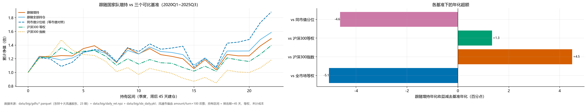

# 跟踪国家队 v2：换基准 + 拉长样本

> 2026-11-14｜23 期十大流通股东（20200331 ~ 20250930）｜22 个持有区间｜滞后 45 天建仓、季度调仓、等权、未计成本

## 一、为什么这版要换基准

v1 的结论是「跟随增持年化 17.2% vs 全市场等权 33.8%，跑输 16.6pp」，但它有两个硬伤：

- **样本太短**：只有 6 个区间，全落在 2024Q1~2025Q3 这一年半（小微盘暴涨、红利/银行滞涨）；
- **只有一个基准**：全市场等权天然超配小市值，而国家队持仓市值中位 143 亿、全市场 42 亿，
  差 3.4 倍，等于让一个偏大盘组合去跑小盘赛跑。

这版补三个更公平的对照：

| 基准 | 定义 | 它回答什么 |
|---|---|---|
| 全市场等权 | 全部股票等权 | v1 的口径，只作参照 |
| 沪深300 指数 | 真实指数点位（市值加权） | 「跑赢大盘了吗」 |
| 沪深300 等权 | **代理**：每期流通市值前 300 只等权 | 「同样的股票池，等权持有效果如何」 |
| **同市值分位组** | 全市场按流通市值分 10 组，按组合在各组的权重加权各组等权收益 | 「同样的市值分布下，选股有没有超额」 |

最后一行的基准和组合**市值分布完全一致**，两者之差才是纯选股能力。

## 二、流通市值怎么算

没有现成市值字段，用换手率反推：`流通市值 = 成交额 / 换手率 × 100`。
它天然避开复权因子与股本变更——成交额和换手率都是当日真实值。
校验：平安银行 2,293 亿（真实约 2,400 亿）、贵州茅台 16,321 亿（真实约 1.8 万亿），
误差 5~10%，足够做十分位分组。取 20 日均值平滑。

## 三、主结果

| 基准 | 基准年化 | 跟随增持年化 | 年化超额 | 单期超额均值 | t | p | 胜率 |
|---|---|---|---|---|---|---|---|
| 全市场等权 | +12.7% | +7.6% | **-5.1pp** | -1.41% | -1.38 | 0.182 | 32% |
| 沪深300指数 | +3.1% | +7.6% | **+4.5pp** | +1.12% | +0.80 | 0.435 | 59% |
| 沪深300等权 | +6.3% | +7.6% | **+1.3pp** | +0.47% | +0.48 | 0.636 | 59% |
| 同市值分位 | +12.2% | +7.6% | **-4.6pp** | -1.30% | -1.26 | 0.220 | 32% |

## 四、逐区间明细（%）

| 区间 | 跟随增持 | 沪深300指数 | 沪深300等权 | 同市值分位 | 超额(vs 同市值) | 增持只数 |
|---|---|---|---|---|---|---|
| 20200331→20200630 | +23.43 | +20.24 | +21.75 | +21.47 | **+1.96** | 133 |
| 20200630→20200930 | -0.46 | +4.24 | +0.33 | -1.37 | **+0.92** | 187 |
| 20200930→20201231 | +1.45 | +17.62 | +11.69 | -9.26 | **+10.71** | 107 |
| 20201231→20210331 | -0.39 | -10.11 | -6.43 | +5.70 | **-6.10** | 126 |
| 20210331→20210630 | +8.65 | -4.70 | +2.59 | +12.72 | **-4.07** | 107 |
| 20210630→20210930 | +3.08 | -1.19 | +0.87 | +3.14 | **-0.06** | 119 |
| 20210930→20211231 | -7.22 | -6.77 | -6.21 | -1.73 | **-5.49** | 114 |
| 20211231→20220331 | -11.32 | -13.08 | -10.85 | -12.06 | **+0.74** | 115 |
| 20220331→20220630 | +18.66 | +5.79 | +8.66 | +18.00 | **+0.66** | 144 |
| 20220630→20220930 | -6.38 | -9.36 | -6.53 | -4.20 | **-2.18** | 166 |
| 20220930→20221231 | +6.20 | +9.26 | +5.88 | +8.67 | **-2.47** | 142 |
| 20221231→20230331 | -6.67 | -3.53 | -3.90 | -5.57 | **-1.10** | 187 |
| 20230331→20230630 | -1.98 | -3.58 | -0.69 | +1.31 | **-3.29** | 132 |
| 20230630→20230930 | -2.77 | -7.10 | -5.46 | +1.95 | **-4.72** | 218 |
| 20230930→20231231 | -12.13 | -4.98 | -4.91 | -22.28 | **+10.15** | 188 |
| 20231231→20240331 | +12.48 | +6.53 | +7.06 | +12.31 | **+0.17** | 180 |
| 20240331→20240630 | -12.52 | -8.74 | -6.86 | -11.16 | **-1.35** | 186 |
| 20240630→20240930 | +21.64 | +22.07 | +19.32 | +33.10 | **-11.46** | 169 |
| 20240930→20241231 | -1.60 | -2.49 | -2.45 | +1.08 | **-2.68** | 171 |
| 20241231→20250331 | -0.05 | -0.81 | -1.95 | +2.69 | **-2.74** | 122 |
| 20250331→20250630 | +11.65 | +6.81 | +8.99 | +16.60 | **-4.95** | 152 |
| 20250630→20250930 | +7.85 | +10.90 | +10.43 | +9.11 | **-1.27** | 188 |

## 五、分年度

| 年 | 跟随增持 | 同市值分位 | 沪深300 指数 | 单期超额均值 |
|---|---|---|---|---|
| 2020 | +24.2% | +14.9% | +32.5% | +1.87% |
| 2021 | -7.9% | +0.5% | -23.7% | -2.22% |
| 2022 | +10.1% | +16.0% | +1.1% | -1.27% |
| 2023 | -5.8% | -9.8% | -9.3% | +0.58% |
| 2024 | +4.7% | +22.7% | +7.8% | -4.56% |
| 2025 | +20.4% | +27.2% | +18.5% | -3.11% |

## 六、只看「增持」有用吗

| 策略 | 年化 |
|---|---|
| 跟随「增持」的股票 | +7.6% |
| 跟随国家队**全部持仓**（不筛增持） | +8.7% |
| 差（增持 - 全部） | **-1.1pp** |

单期差 -0.21%、t = -0.46、p = 0.652、胜率 41%。**「增持」这个动作本身没有信息**——
只挑增持的反而略差。这也合理：国家队增持常见于「跌多了被动补仓 / 指数化建仓」，
不是因为看好某只股票；而它的存量持仓才是长期选出来的。

## 七、结论

1. **v1 的「跑输 16.6pp」主要是样本区间造成的**：同样对全市场等权，样本拉长到 2020-2025 后只剩 -5.1pp。
   而且换不换基准几乎不影响（全市场等权 +12.7% vs 同市值分位 +12.2%，只差 0.4pp），
   也就是说，v1 那句「基准选错了」其实站不住：全市场等权和同市值分位在这个样本里几乎一样。
   真正的原因是那一年半的行情，不是基准。
2. **对沪深300 指数是跑赢的（+4.5pp/年），但不显著（t = 0.80）**；
   而且这份超额几乎全部来自**风格**——沪深300 指数市值加权 +3.1%，同样 300 只等权 +6.3%，
   光把权重从市值改成等权就差 3.2pp。组合偏中小盘（持仓市值中位 143 亿 vs 全市场 42 亿，3.4 倍），
   这个偏离在 2021-2025 的小盘行情里天然占优。
3. **同市值对照下是跑输的（-4.6pp/年，p = 0.220）**：把市值维度对齐之后，
   「国家队持仓」在同一个市值桶里没有选出更好的股票，反而略差；不显著，只能说「没有证据表明会选股」。
4. **「增持」信号本身无效**（见第六节）：跟随全部持仓 8.7% > 跟随增持 7.6%。
5. 45 天滞后没变：等你看到季报，公告后那段涨幅已经走完。

## 八、局限

- **沪深300 等权是代理**：没有历史成分表，用「每期流通市值前 300」代替；中证 300 按自由流通市值选样，
  代理与真实成分的重合度约 8~9 成，个别年份（如 2021 年抱团调整）偏差更大。真实指数点位那条不受影响。
- 流通市值由换手率反推，误差 5~10%；对「取前 300」和「十分位分组」够用，但不能用来算精确权重。
- 仍用报告期而非公告日，前视偏差残留；「增持」是各账户合计，会混入社保组合间调仓。
- 未计成本：季度换 150~250 只，双边 15bp 约 0.4~0.6%/年。
