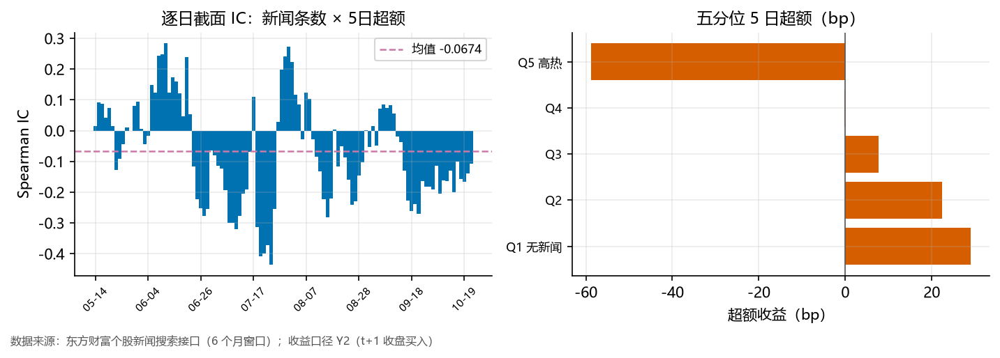

# 新闻反指检验：媒体关注度 vs 后续收益

**一句话**：东财个股新闻只能回溯 6 个月（2026-05-14 起硬上限），全市场抓取后构建「过去 20 个交易日新闻条数」因子，在 108 个评估日上做逐日截面检验。

## 动机与文献

- Fang & Peress (2004)：无媒体覆盖的股票系统性跑赢高覆盖股票（"no-coverage premium"，月频 ~2.5%）；Tetlock (2007)：高关注度预示低收益。
- A 股语境的"新闻反指"直觉：被密集报道的票往往是行情走到极致/情绪顶点。

## 数据

- 来源：东财搜索接口按代码全文检索（等价于"该股被提及次数"），按时间倒序翻页，单只最多 10 页；
- **窗口只有 6 个月**：接口硬上限 2026-05-14，抓取 510983 条新闻 / 5183 只有报道；
- 时点处理：当日 15:00 前发布的新闻算当日可知，收盘后发布算下一交易日（收盘价出信号，无泄漏）；
- 因子：cnt20 = 过去 20 个交易日的新闻条数；次新股按"过去 60 日有效收益 ≥55 天"剔除；
- 前瞻收益：Y2 口径（t 收盘出信号 → t+1 收盘买入 → 持有 5/20 日），截面去均值。

## 结果

| 检验 | 数值 | 判定 |
|---|---|---|
| 逐日 IC（5 日） | **-0.0674**（t=-4.25，p=0.000，正日占比 37%） | 有效反指 |
| 逐日 IC（20 日） | -0.1054（p=0.000） | 有效反指 |
| 五分位 Q5−Q1（5 日） | **-0.88%**（p=0.029） | |
| 五分位 Q5−Q1（20 日） | -2.69%（p=0.002） | |
| **残差 IC（5 日，控制 ret5/dev20/size/turn20/momq60）** | **-0.0048**（t=-0.88，p=0.384） | 被量价因子吸收 |

五分位 5 日超额（bp/日）：Q1 29 / Q2 22 / Q3 8 / Q4 -0 / Q5 -59。

混杂强度：新闻条数与 |ret5| 的秩相关均值 **0.244**——新闻天然跟着行情走，所以原始 IC 的一部分是 A 股短期反转的换皮。剔除五个量价因子的秩影响后，残差 IC 为 -0.0048（p=0.384）。

## 结论

**新闻热度的反指表象主要是量价混杂**：原始 IC -0.0674（p=0.000）很好看，但剔除ret5/dev20/size/turn20/momq60 后残差 IC 只剩 -0.0048（p=0.384）——新闻条数本质上是「近期涨跌幅/换手」的代理变量，反的是波动不是新闻。与 WQ101 复现里"价量背离"的命运相同：单因子有味，模型无增量。

## 三条必须写的警示

1. **评估窗全落在封存段**（2026-06~10，lockbox 已消耗）：任何数字只能作描述性证据，不得用于选股/入库决策；
2. **窗口只有 6 个月、约 109 个交易日**：IC 的 t 检验基于 108 个日度观测，跨周期稳健性完全无法检验；
3. **覆盖偏差与口径**：按代码全文检索会把"顺带提及"也算进来；日均 92.6% 的股票有非零新闻——0 条组只剩约 7%，"无闻组"其实很小、且偏向冷门股与次新，Q1 的 29bp 正超额不能简单读成 no-coverage premium。

## 逐日 IC 的时间结构（图上可见）

窗口前段（5 月中~6 月）IC 偏正（新闻动量），7 月后持续转负——同一因子在 6 个月内经历方向切换。若把前 30 天单独算，IC 符号可能与后段相反：这既是"窗口太短"的又一佐证，也提示新闻热度→收益的映射依赖当时的行情 regime，不是稳定关系。

## 与项目内其他"注意力/事件"证据的关系

- 业绩预告三切法（类型/文本/公告 vs 预期）均无 5~60 日可交易超额——若本检验显著，说明信号在"被报道"这个通道而不在"业绩信息"本身；若不显著，与事件族阴性结果一致。
- 缠论 zs_pos 走的是量价结构通道（通过 5 折 CV 增量门）；本因子若要入库，同样必须过 CV 增量，而 6 个月数据无法支持 CV——**候选资格都不具备**。